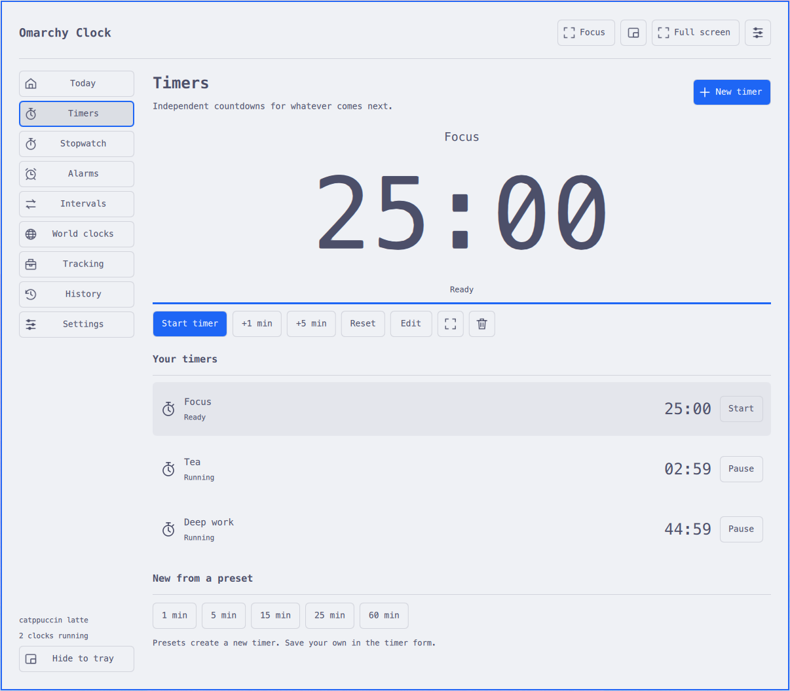
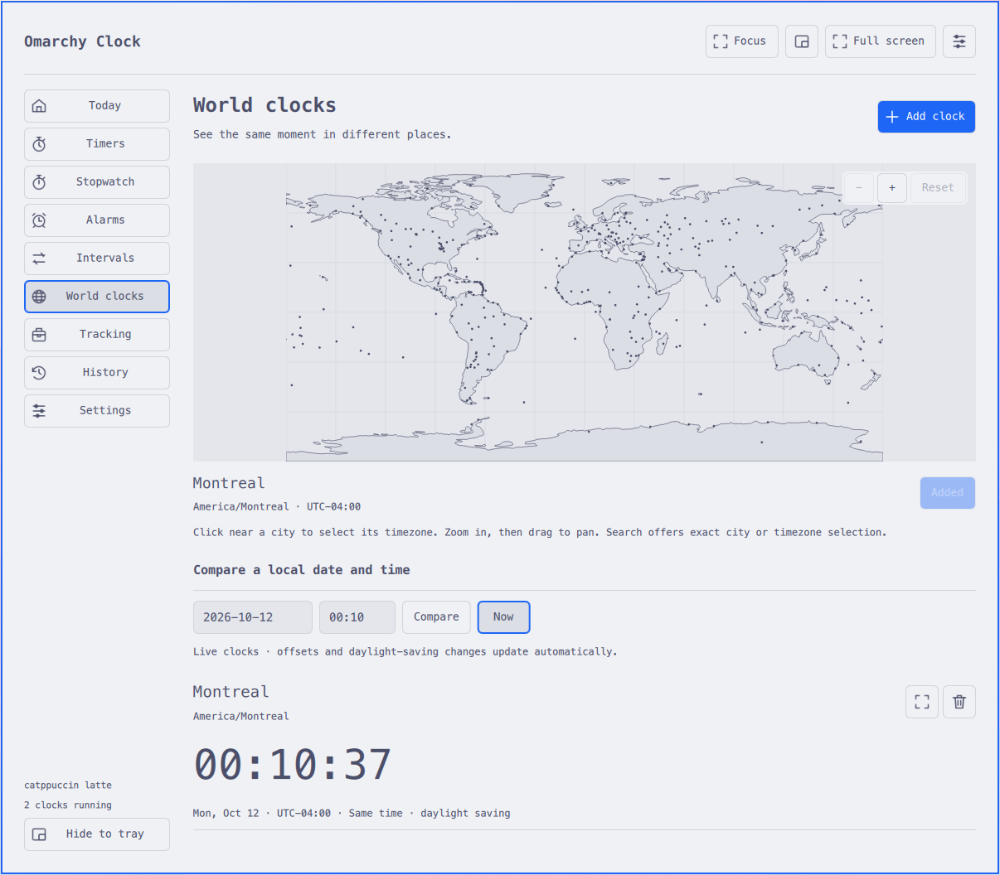
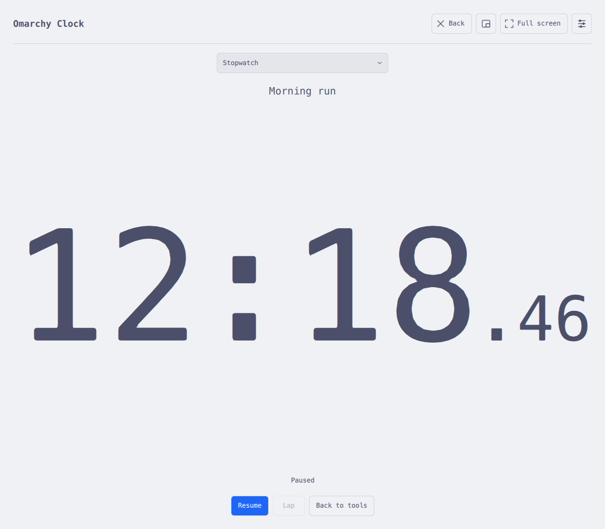
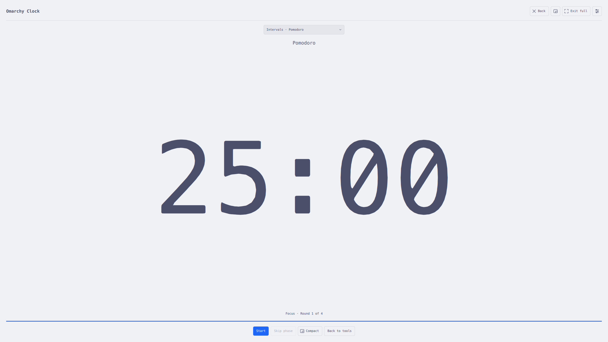
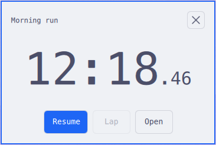
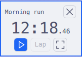

# Omarchy Clock 2.1.3

A native Qt Quick timekeeping app for Omarchy. It follows the current Omarchy colors and font, runs locally, and keeps clocks active while its window is hidden in the tray.

Open **Omarchy Clock** from the application launcher or run `omarchy-clock`.

Launching an existing instance brings its window to the current Hyprland workspace. It preserves a valid position and size, and recenters a window left off-screen after a monitor change. The global show/hide shortcut hides a focused main window; otherwise it brings the window forward.

## Screenshots

Captured from the native app alone on an empty Omarchy workspace, using illustrative sample activity and the Catppuccin Latte theme. App colors follow your active Omarchy theme.







<details>
<summary>Fullscreen interval Focus with horizontal controls</summary>



</details>

The compact display stays open when the main window is hidden, and shrinks down to 160×110:




## Tools

| Tool | What it does |
| --- | --- |
| Today | Local time, active clocks, upcoming alarms, and recent history. |
| Timers | Up to 50 independent named countdowns; presets, custom hours/minutes/seconds, repeats, pause/reset, and add time. Save a preset while creating a timer. |
| Stopwatch | Named session, pause/resume, up to 1,000 laps, best/slowest splits and average, **Save & new** to archive sessions. Fractions sit beside seconds; choose hundredths or milliseconds in Settings. |
| Alarms | One-off dates or recurring weekdays, weekends, daily, or custom days; IANA timezone, enable/disable, snooze, dismiss, and optional sound. |
| Intervals | Built-in Pomodoro and workout programs, plus custom sequences of 1–20 named phases and 1–99 rounds. Independent programs can run together; pause/reset or skip the current phase. |
| World clocks | Click an offline world map to select a timezone city; zoom/pan or search exact city/timezone names, favorite up to 30 zones, see UTC offsets, local differences and daylight-saving status, or compare a specific local date/time. |
| Tracking | Name an activity and project, pause/resume, finish, and view daily totals, the rolling last seven days, and project totals. Pauses are excluded from tracked time. |
| History | Search names/projects, filter type, page through records, inspect saved lap data, delete records with confirmation, and export CSV. |
| Settings | Alerts, precision, clock format, startup page, tray/login preferences, presets, projects, data folder and keyboard reference. |

Editing a paused timer or program resets its progress to the new definition. A paused tracking activity can be resumed or replaced with another activity; its recorded segments stay in History. Interval history records the nominal program duration, including manually skipped phases. Timers record completed nominal cycles. Stopwatch and tracking durations retain exact milliseconds.

## Windows and keyboard

The main window floats and resizes freely, with a 380×460 minimum. Drag empty space in the header to move it; drag its corners or use Omarchy's usual window resize gesture. The wide navigation rail becomes a tool selector below 960 pixels.

**Focus** removes the tool navigation and enlarges the selected clock. **Full screen** fills the monitor. The **compact display** is a separately resizable floating window (360×240 initially, down to 160×110), pinned across workspaces by its app-specific Hyprland rule. It follows the main app's chosen focus clock. Hiding or closing the main window to the tray leaves the compact display open; closing the compact display affects only that window. Explicitly quitting the app closes both.

| Shortcut | Action |
| --- | --- |
| `Space` | Start/pause the selected timer, stopwatch, interval, or tracking activity. |
| `L` | Record a stopwatch lap. |
| `F11` | Enter/leave fullscreen. |
| `Escape` | Leave fullscreen, then leave focus; cancel a confirmation. |
| `Ctrl+1` … `Ctrl+9` | Switch tools in navigation order. |
| `Ctrl+Shift+M` | Open/close the compact display. |
| `Ctrl+W` | Close the focused window; main closes to tray when enabled. |
| `Super+Ctrl+Alt+C` | Show/hide the app globally. |
| `Super+Ctrl+Alt+Space` | Start/pause its focused clock globally. |

Text entry protects Space/L from starting clocks. The installer selects unused global bindings and records their actual names in Settings without replacing existing bindings.

## Map and Omarchy bar

World clocks includes an offline map. Click near a city, confirm the selected city/timezone below it, then choose **Add clock**. Use **+ / −** or Ctrl+wheel to zoom, then drag to pan; Reset restores the full world. The open-hand cursor closes while you drag, and the map keeps the pointer until release. Resizing preserves its geographic proportions and panned region; padding around the fitted map cannot select a city. Arrow keys move the map selection. **Add clock** in the page header reveals city/timezone search; search also supports timezone aliases. No search match shows an inline recovery hint. The map selects the nearest IANA representative timezone city, not an address or exact timezone boundary. It uses bundled Natural Earth land outlines and IANA tzdata coordinates; see [map sources](data/README.md).

A user-owned **Omarchy Clock** bar widget is installed beside Chime when present. It shows the focused running clock, another active clock, or the last paused clock for resume. Timer, stopwatch, interval and tracking activity are supported. `+N` counts other active clocks; hover lists them. Chime's own clocks stay independent.

- **Click:** open the displayed clock in Focus.
- **Right-click:** pause/resume the displayed clock.
- **Middle-click:** open its compact display.

Ready/finished clocks disappear. Settings → **Background operation** → **Show active clocks in the Omarchy bar** hides the widget. It reads app state once per second, hides stale data after six seconds, and removes the readout on normal app exit. The native app owns timing and alerts, so the widget adds no duplicate notifications.

## Background alerts

Notifications are **silent by default**,  Sound is opt-in per clock or globally in Settings. The notification daemon receives `suppress-sound`; the app plays its own optional alarm sound through the existing PipeWire/PulseAudio player.

Closing the main window keeps the app running when a tray is available and **Keep running when the window closes** is enabled. The tray menu opens each tool, pauses active clocks, controls the focused clock, opens the compact display, and quits. Without a tray, close follows the quit flow; active clocks and armed alarms trigger a confirmation.

Login startup is enabled on first suite installation and can be disabled in Settings. It starts hidden. One local instance handles launcher and global shortcut commands.

The app does not wake or power on the computer. Suspend delays alerts until wake. Quitting stops delivery; running clocks persist and catch up when reopened. Delayed repeat cycles and interval phases coalesce into one notification instead of flooding the desktop. At a daylight-saving gap, an alarm moves forward by the skipped interval (02:30 becomes 03:30 for a one-hour gap). At a repeated hour, it rings at the first occurrence once; the next recurrence is the following scheduled day. World-clock comparison rejects ambiguous or missing local times.

## Data, export and backups

Everything stays on your machine; no account, cloud connection, telemetry, or network service is used.

- Database: `~/.local/share/omarchy-clock/clock.sqlite3`.
- Window/selected-clock preferences and preserved v1 data: `~/.config/OmarchyClock/Omarchy Clock.conf`.
- Actual installed shortcut names: `~/.local/share/omarchy-clock/integration.json`.
- Login toggle: `~/.config/autostart/omarchy-clock.desktop`.
- Bar plugin: `~/.config/omarchy/plugins/jeanc.omarchy-clock/`, configured in `~/.config/omarchy/shell.json`.
- Private live bar bridge: `$XDG_RUNTIME_DIR/omarchy-clock-status.json` (no history or laps).
- User-owned window rules and global bindings: `~/.config/hypr/omarchy-clock.lua`, required by `hyprland.lua`.
- Timestamped installation backups: `~/.local/share/omarchy-clock/backups/`.

SQLite commits a completion and its history record atomically. Active state checkpoints every five seconds and saves on actions and normal exit. A failed history write keeps the previous active clock/activity recoverable and shows an error. Invalid saved state is preserved instead of overwritten. Existing timer, stopwatch elapsed time, and laps migrate from v1 on the first suite launch.

CSV export uses UTF-8, CRLF rows, quoted fields, UTC ISO timestamps and exact millisecond durations. Stopwatch lap rows carry split and cumulative times. **Export all** uses the selected type across the entire database, including records beyond the current page; it does not restrict export to the text search. **Export session** exports only that record and its laps.

To back up manually, quit through the app menu and copy the database and preferences. To restore, quit first and replace them from the desired backup. Avoid copying a live database without its WAL; use SQLite's backup API if it is running. Runtime countdowns use Linux `CLOCK_BOOTTIME`, so changing the wall clock does not alter them and suspend time counts. Recovery after a full app restart estimates the intervening duration from saved wall time.

## Build, test and reinstall

Requires Qt 6.7+ Quick, Quick Controls, Widgets, DBus, Network, Sql (SQLite plugin), and C++20, CMake and Ninja. Qt Test is needed when building tests. The installer targets Omarchy with Hyprland Lua configuration and `omarchy-shell`. It also needs `desktop-file-validate` and desktop integration tools. On Arch/Omarchy, build dependencies can be installed with:

```sh
sudo pacman -S --needed base-devel cmake ninja qt6-base qt6-declarative desktop-file-utils
```

```sh
cmake -S . -B build -G Ninja -DCMAKE_BUILD_TYPE=Release
cmake --build build -j4
ctest --test-dir build --output-on-failure
python install.py
```

The installer validates the desktop file, gracefully stops an existing instance, backs up replaced files/data, installs the binary/icon/launcher, adds app-specific Lua rules and unused shortcuts plus the user-owned bar widget, reloads Hyprland, checks config errors, restores replaced files on integration failure, then waits for the migrated native window to open. It backs up bar configuration/plugin files and preserves later manual removal of the widget. It preserves an existing choice to disable login startup.

Useful commands:

```sh
omarchy-clock --toggle
omarchy-clock --pause-focused
omarchy-clock --compact
omarchy-clock --background
omarchy-clock --save-and-quit
```

`--background` never brings an existing instance to the foreground. Capture/test commands use temporary in-memory data:

```sh
QT_QPA_PLATFORM=offscreen QT_QPA_PLATFORMTHEME= QT_QUICK_BACKEND=software \
  ./build/omarchy-clock --capture /tmp/clock.png --demo --page Stopwatch
python capture.py
python capture-extension.py
```

`--demo` only works with `--capture`; it never adds example history to your actual database. `--test-bar` is a separate manual integration fixture with an in-memory backend and a real desktop bridge; it also skips preference/data persistence. Review screenshots with sample activity are illustrative. `capture.py` requires Pillow, produces the complete desktop/narrow/form/focus matrix, and leaves production untouched.

Implementation: `timekeeper.cpp` owns clocks, scheduling, storage and reports; `desktop.cpp` owns notifications, tray, sound and login integration; `Main.qml` and `ui/` provide the native Qt Quick interface. `clockmodel.cpp` retains the live theme reader and tested v1 timing code.

The scheduling implementation follows [Qt's documented timezone transition behavior](https://doc.qt.io/qt-6/qdatetime.html). Desktop rules use the current [Hyprland Lua window-rule syntax](https://wiki.hypr.land/Configuring/Basics/Window-Rules/).

Additional verification commands (the two native checks require the running desktop session):

```sh
node bar-model-tests.mjs             # optional Node: stale state and readout rules
python native-launch-check.py        # real launcher visibility, preserves clocks
python bar-integration-check.py      # sample backend; restores the real app afterward
omarchy-shell omarchy-clock-bar status
```

The bar's source and bridge contract are documented in [bar-plugin/README.md](bar-plugin/README.md). Open dropdown rows and selected states use explicit live theme colors in both light and dark themes.

## License

Application source is licensed under [MIT](LICENSE). Bundled map data is public domain; its sources and attribution are recorded in [data/README.md](data/README.md). Qt and system dependencies retain their own licenses.
